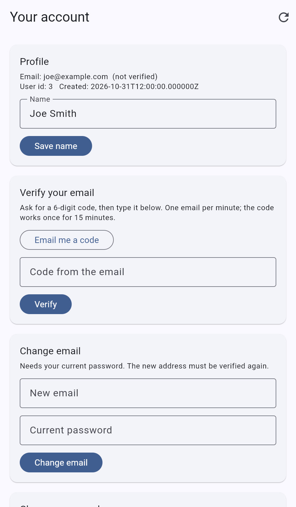

# SimpleAPI Auth API: Flutter web sample

A small Flutter web app that shows how to call the free [SimpleAPI Auth API](https://auth.simpleapi.dev) from a browser, with no backend of your own.

**[Live demo](https://simple-api-dev.github.io/auth-client/)** | **[API docs](https://auth.simpleapi.dev/docs)** | **[Get a free key](https://keys.simpleapi.dev/?product=auth)**



## Run it

```bash
flutter pub get
flutter test
flutter run -d chrome --dart-define=SIMPLEAPI_KEY=YOUR_KEY
```

Without `--dart-define` the app starts without a key. It then asks you to paste one under Settings and makes no API calls until you do. Never commit a key.

## How it calls the API

Every request goes to `https://auth.simpleapi.dev` and carries your key as the `apikey` query parameter. Calls for a logged-in user also send the session token as a bearer token. The API allows any origin (CORS), so the browser calls it directly.

```dart
final uri = Uri.parse('https://auth.simpleapi.dev')
    .replace(path: '/api/users/me', queryParameters: {'apikey': apiKey});
final response = await http.get(uri, headers: {
  'Accept': 'application/json',
  'Authorization': 'Bearer $token', // only on calls that need a logged-in user
});
```

Login and register never send the bearer token. A `401` on a call made while logged in drops the token and shows the login screen again.

## Screens and API calls

| Screen | What it does | API call |
| --- | --- | --- |
| Settings | Paste your own key, check it, go back to the demo key | `GET /api/keys/check` (200 for a good key, 401 for a bad one); the key is stored in localStorage |
| Log in | Log in; shows the 15 minute lockout after 5 wrong passwords | `POST /api/users/login` |
| Create an account | Register and be logged in | `POST /api/users/register` |
| Reset password, step 1 | Email a 6-digit code | `POST /api/users/forgot` |
| Reset password, step 2 | Set a new password with the code | `POST /api/users/reset` |
| Your account: Profile | Show the profile, edit the name | `GET /api/users/me`, `PUT /api/users/me` |
| Verify your email | Email a code, then confirm it | `POST /api/users/me/email/send-code`, `POST /api/users/me/email/verify` |
| Change email, Change password | Needs the current password | `PUT /api/users/me` |
| Log out | This device, or all devices | `POST /api/users/logout` (`{"all": true}` for all) |
| Delete account | Needs the password | `DELETE /api/users/me` |

The admin calls (`/api/users`, `/api/users/{id}`) are for the owner of the key and are not used here. Errors are turned into plain text in one function, `describeError` in `lib/auth_api.dart`.

## Keys

The live demo opens on the login screen. It uses a shared demo key that is compiled into the site, so visitors do not have to paste anything.

- **Use your own key.** Open Settings and paste a key from [keys.simpleapi.dev](https://keys.simpleapi.dev/?product=auth). The key is checked with the API, stored only in your browser (localStorage), and used instead of the demo key. "Go back to the demo key" removes it again.
- **25 users per key on the free tier.** The shared demo key can fill up. When it does, registering shows that the demo is full and points to Settings.
- **Demo accounts are shared and public.** Do not use a real password or any private details.

## Good to know

- Passwords are 8 to 72 characters. Emails are not case sensitive.
- Five wrong passwords lock that email for 15 minutes (`429`). Reset and verification codes work once, last 15 minutes and allow 5 wrong tries. A key can send 20 reset and verification emails a day.
- Wrong login `401`, duplicate email `409`, malformed JSON `400`, validation `422`, rate limit `429` (60 requests a minute per IP address).
- The session token is kept in memory only, so reloading the page logs you out. Your own key stays saved.
- The only dependency besides Flutter is the `http` package.

## Project layout

| File | Purpose |
| --- | --- |
| `lib/auth_api.dart` | The whole API client, `ApiException` and `describeError` |
| `lib/models.dart` | `User` and `Session` |
| `lib/app_state.dart` | App state (key, logged-in user) as a `ChangeNotifier` |
| `lib/config.dart` | The build-time demo key (`SIMPLEAPI_KEY`) |
| `lib/key_store*.dart` | Remembers your own key in localStorage |
| `lib/open_url*.dart` | Opens a link in a new tab |
| `lib/screens/` | One file per screen, and `ui.dart` with the shared widgets |
| `test/` | Unit and widget tests with a mocked HTTP client, and `live_shapes/` with real API answers replayed through the client |

## Deploy to GitHub Pages

`.github/workflows/pages.yml` runs `flutter analyze` and `flutter test`, builds with `--base-href /auth-client/`, and deploys with the official Pages actions on every push to `main`. In the repository settings, set Pages > Source to GitHub Actions once.

The demo key is passed with `--dart-define=SIMPLEAPI_KEY=${{ vars.SIMPLEAPI_KEY }}`. Create a repository variable named `SIMPLEAPI_KEY` under Settings > Secrets and variables > Actions > Variables. If it is missing the site still builds, without a key.

Anything passed with `--dart-define` is readable in the public JavaScript of the site. Use a dedicated key registered to a spare email address, never your own key or address. Expect strangers to use it and fill it up.

## License

MIT, see [LICENSE](LICENSE).
